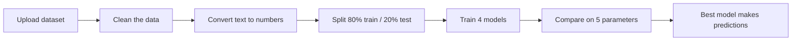

<h1 align="center">Disease Prognosis using Machine Learning</h1>

<p align="center">
  Upload a patient dataset and get four machine learning models trained, compared and ready to predict, live in your browser.
</p>

<p align="center">
  <a href="https://disease-prognosis-ml-a3nptdvnfbbazksnmkyd3k.streamlit.app/"></a>
  <a href="https://colab.research.google.com/github/dhamankaranuj-jpg/disease-prognosis-ml/blob/main/Disease_Prognosis_Colab.ipynb"></a>
</p>

---

## About the project

Chronic Kidney Disease (CKD) often goes unnoticed until it is advanced. This project shows how machine learning can screen patients from routine clinical measurements such as blood pressure, haemoglobin and serum creatinine.

It began as a **CKD prognosis system** built on the UCI Chronic Kidney Disease dataset, and was then made generic: the web app accepts any tabular disease dataset that has a result column.

| | |
|---|---|
| **Institute** | Symbiosis Institute of Technology, Nagpur |
| **Course work** | Semester 3, Project-Based Learning (PBL) |
| **Web app** | [Open the live app](https://disease-prognosis-ml-a3nptdvnfbbazksnmkyd3k.streamlit.app/) |
| **Notebook** | [Open in Google Colab](https://colab.research.google.com/github/dhamankaranuj-jpg/disease-prognosis-ml/blob/main/Disease_Prognosis_Colab.ipynb) |
| **Project report** | [Project_Report.pdf](Project_Report.pdf) |

## How to use the web app

1. Open the [live app](https://disease-prognosis-ml-a3nptdvnfbbazksnmkyd3k.streamlit.app/). The first load can take 20 to 30 seconds.
2. Upload a dataset from the left panel (`.csv`, `.xlsx` or `.zip`).
3. Check the **Result column**. It is detected automatically, and you can change it from the dropdown.
4. Wait a few seconds while the four models train.
5. Explore the four tabs:

| Tab | What you get |
|---|---|
| Model Comparison | Accuracy, Precision, Recall, F1-Score and AUC-ROC for all four models, with a chart |
| Predict a Patient | A form built from your dataset's columns that returns a prediction with confidence |
| Full Patient Results | Actual versus predicted result for every patient, with a CSV download |
| Feature Insights | The attributes the best model relies on most |

## How it works



1. **Clean:** missing values written as `?`, extra spaces, tabs and ID columns are fixed or removed. Missing numbers are filled with the median, and missing categories with the most common value.
2. **Encode:** text values such as `yes / no` or `normal / abnormal` are converted to numbers.
3. **Split:** 80% of the patients teach the model, and the other 20% are kept unseen to test it.
4. **Train and compare:** all four models are scored on the same test data.
5. **Predict:** the model with the highest accuracy is used for the prediction tab.

## Models used

| Model | Idea in one line |
|---|---|
| Random Forest | Many decision trees vote together for the final answer |
| XGBoost | Trees are built one after another, each fixing the mistakes of the last |
| Decision Tree | A flowchart of yes/no questions on the patient's values |
| Logistic Regression | A formula that estimates the probability of the disease |

## Evaluation parameters

| Parameter | What it tells us |
|---|---|
| Accuracy | How many predictions were correct overall |
| Precision | Of the patients flagged as diseased, how many really were |
| Recall | Of the patients who really had the disease, how many were caught |
| F1-Score | A balance of precision and recall |
| AUC-ROC | How well the model separates the classes at every threshold |

## Limits

Up to 5000 patients (rows), 100 attributes (columns) and 20 result classes per dataset.

## Repository files

| File | Purpose |
|---|---|
| `disease_prognosis_app.py` | Streamlit web app |
| `Disease_Prognosis_Colab.ipynb` | Step-by-step notebook for Google Colab |
| `requirements.txt` | Python libraries needed |
| `Project_Report.pdf` | Full project report |

## Run it on your computer

```bash
pip install -r requirements.txt
python -m streamlit run disease_prognosis_app.py
```

## Built with

Python, pandas, NumPy, scikit-learn, XGBoost and Streamlit.

## Disclaimer

This is a student project made for learning. It is not a medical device, and its output must not be used for real diagnosis or treatment decisions.
